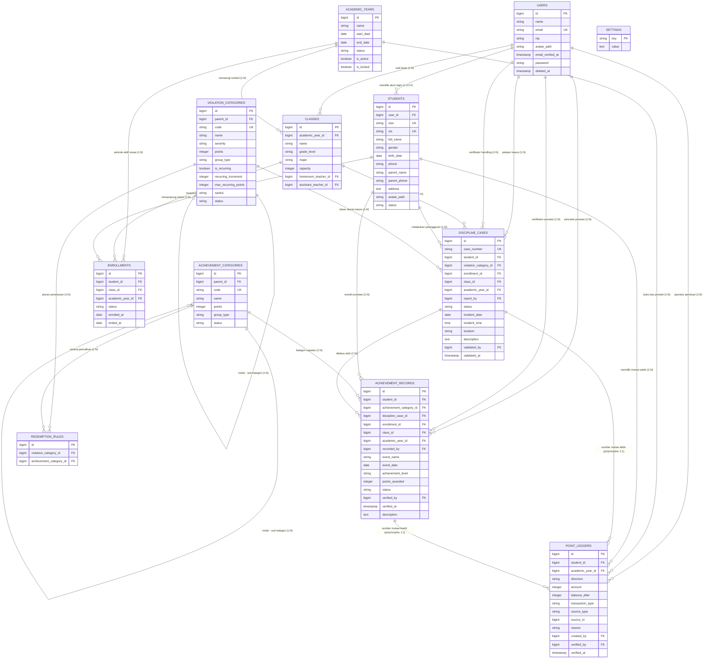

# Entity Relationship Diagram (ERD) - Sistem Pelanggaran Siswa

Dokumen ini memodelkan seluruh entitas basis data relasional pada sistem **Pelanggaran Siswa (Pelanggaran Kuy)** beserta kardinalitas relasi antar-tabel.

---

## 1. Diagram ERD Lengkap (Mermaid)

---

## 2. Penjelasan Kardinalitas Relasi (Bahasa Manusia)

1. **`users` ke `students` (1 ke 0..1)**:
   - Satu baris siswa dapat ditautkan ke satu akun user untuk login aplikasi mobile / web siswa. Jika belum memiliki akun, `user_id` bernilai `NULL`.
2. **`academic_years` ke `classes` (1 ke N)**:
   - Setiap rombongan belajar (kelas) terikat persis ke satu tahun ajaran. Saat tahun ajaran berganti, kelas baru dibentuk untuk menjaga arsip historis.
3. **`students` ke `enrollments` ke `classes` (Many-to-Many melalui `enrollments`)**:
   - `enrollments` adalah tabel penghubung (*pivot with history*). Satu siswa dapat memiliki banyak riwayat pendaftaran kelas (kelas X, XI, XII), namun hanya **1 pendaftaran yang berstatus `active`** pada tahun ajaran aktif.
4. **`violation_categories` (Self-Referencing 1 ke N)**:
   - Kategori induk (misal: *P1 Seragam*) memiliki banyak sub-kategori turunan (misal: *P1.1 Tidak Memakai Dasi*).
5. **`violation_categories` dan `achievement_categories` ke `redemption_rules` (Many-to-Many)**:
   - Menghubungkan pelanggaran tertentu dengan sub-prestasi wajib yang dapat memulihkan poin (aturan penebusan restoratif).
6. **`discipline_cases` ke `point_ledgers` (Polymorphic 1 ke 1)**:
   - Saat status kasus pelanggaran dinaikkan dari `found` menjadi `handling`, sistem menerbitkan **tepat 1 baris mutasi DEBIT** pada `point_ledgers` dengan referensi `source_type = DisciplineCase` dan `source_id = discipline_cases.id`.
7. **`achievement_records` ke `point_ledgers` (Polymorphic 1 ke 1)**:
   - Saat rekam prestasi diverifikasi (`verified`), sistem menerbitkan **tepat 1 baris mutasi KREDIT** pada `point_ledgers` dengan referensi `source_type = AchievementRecord` dan `source_id = achievement_records.id`.
