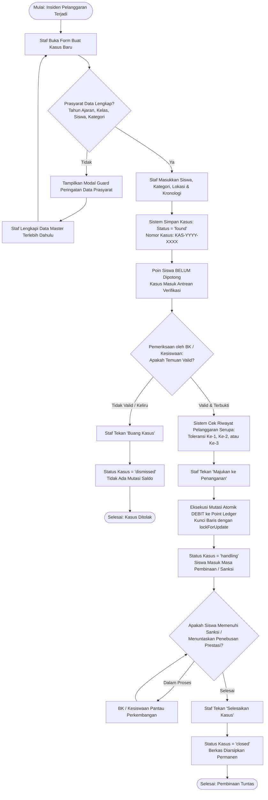
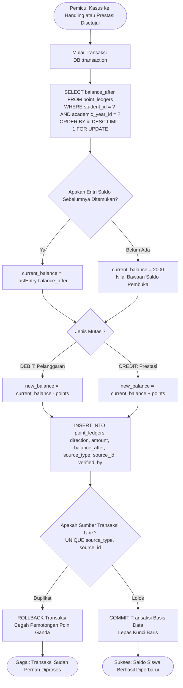
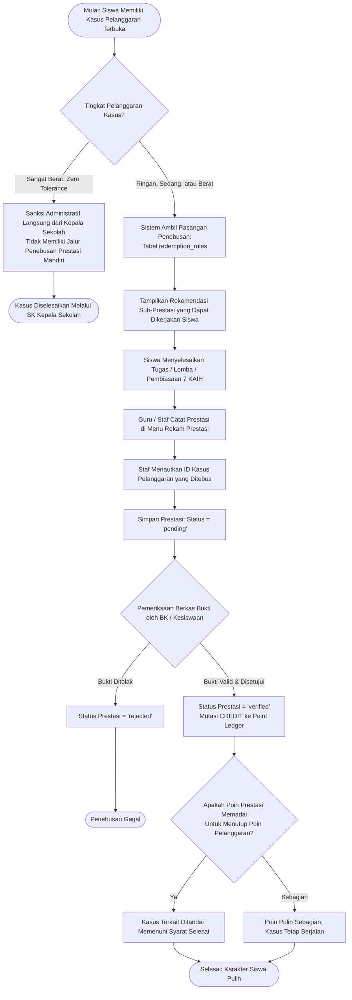
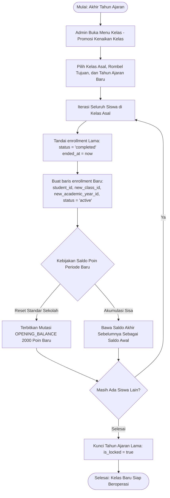
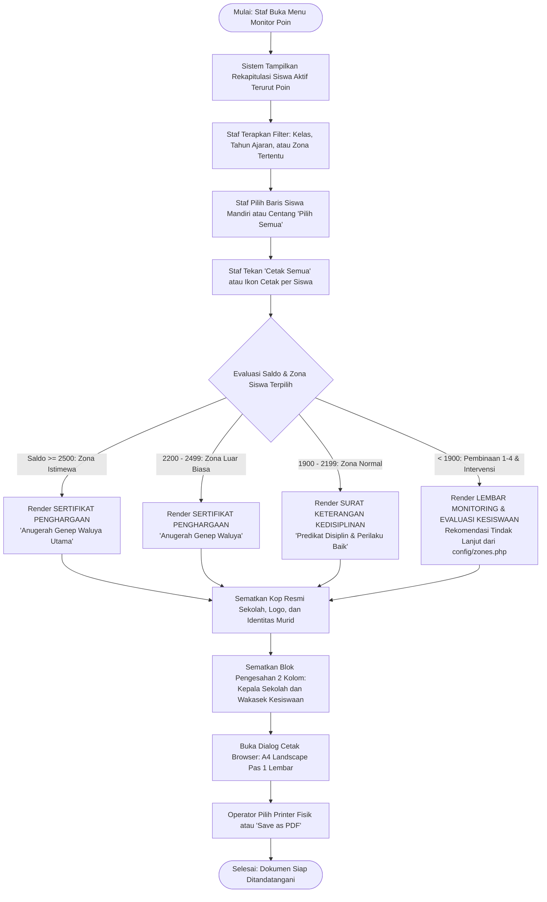

# Diagram Alir Proses Bisnis (Flowcharts)

Dokumen ini memodelkan diagram alir (*flowchart*) logika bisnis utama pada sistem **Pelanggaran Siswa**.

---

## 1. Flowchart Siklus Penanganan Kasus Pelanggaran

Diagram ini menggambarkan alur kerja sejak temuan pelanggaran dicatat staf di lapangan hingga penuntasan sanksi pembinaan.

---

## 2. Flowchart Transaksi Atomik Point Ledger (Append-Only)

Diagram ini mengilustrasikan jaminan integritas buku kas poin dan pencegahan *race-condition* saat pemotongan/penambahan saldo secara bersamaan.

---

## 3. Flowchart Pencatatan & Penebusan Poin Restoratif

Diagram ini memodelkan siklus restoratif di mana pelanggaran tata tertib dipulihkan melalui capaian prestasi (Pedoman Pancawaluya).

---

## 4. Flowchart Kenaikan Kelas & Roll-Over Saldo Poin

Diagram ini menggambarkan proses transisi tahun ajaran baru pada kenaikan tingkat rombongan belajar (Kelas X $\rightarrow$ XI $\rightarrow$ XII).

---

## 5. Flowchart Monitoring Poin & Cetak Sertifikat Kesiswaan

Diagram ini menjelaskan alur seleksi dokumen monitoring kesiswaan berdasarkan acuan resmi *Format Monitoring Program Kesiswaan*.

