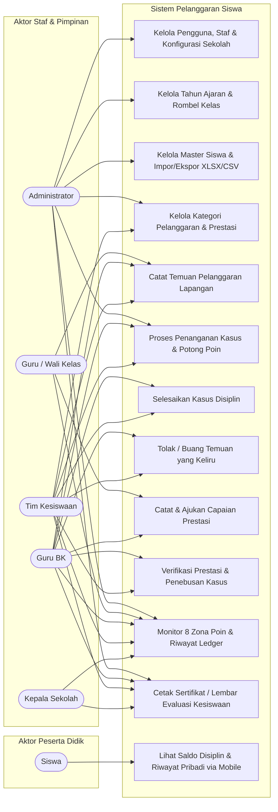

# Use Case Diagram & Spesifikasi Fungsional

Dokumen ini menjelaskan interaksi para pemangku kepentingan (*actors*) terhadap modul-modul sistem pada **Pelanggaran Siswa**.

---

## 1. Diagram Use Case Keseluruhan (Mermaid)

---

## 2. Profil Aktor Sistem

| Aktor | Deskripsi Peran dalam Sekolah |
| :--- | :--- |
| **Administrator** | Penanggung jawab teknis sistem, manajemen akun staf, migrasi kenaikan kelas, dan konfigurasi profil sekolah. |
| **Guru / Wali Kelas** | Pendidik yang memantau perkembangan harian di kelas, mencatat temuan insiden tata tertib, dan mendata prestasi siswa binaannya. |
| **Guru BK (Bimbingan Konseling)** | Konselor yang menangani kasus tingkat sedang s.d. berat, pemanggilan orang tua, dan pembimbingan penebusan poin restoratif. |
| **Tim Kesiswaan** | Penegak disiplin sekolah, penanganan zona kritis, verifikasi pembinaan langsung, dan monitoring ketertiban berkala. |
| **Kepala Sekolah** | Pimpinan satuan pendidikan yang mengawasi tren kedisiplinan, memimpin rapat dewan guru untuk kasus khusus, dan menandatangani sertifikat penghargaan / lembar evaluasi. |
| **Siswa** | Peserta didik yang memantau saldo poin mandiri dan rekam jejak perilaku melalui aplikasi mobile pendamping (*Pelanggaran Kuy*). |

---

## 3. Spesifikasi Rinci Use Case Utama

### UC-01: Pencatatan Temuan Kasus Pelanggaran
- **Aktor Utama**: Guru, Guru BK, Tim Kesiswaan, Administrator.
- **Kondisi Awal**: Siswa melakukan pelanggaran tata tertib di lingkungan sekolah.
- **Alur Utama**:
  1. Staf membuka menu *Kasus Pelanggaran* $\rightarrow$ *Buat Kasus Baru*.
  2. Sistem menampilkan guard modal jika Tahun Ajaran, Kelas, Siswa, atau Kategori belum dibuat.
  3. Staf memilih siswa pelapor (bisa multi-siswa / bulk), kategori pelanggaran, lokasi, tanggal, dan kronologi singkat.
  4. Staf menekan tombol *Simpan Kasus*.
  5. Sistem menerbitkan nomor perkara resmi `KAS-YYYY-XXXX` dengan status awal **`found` (Temuan)**.
- **Kondisi Akhir**: Berkas kasus tersimpan di sistem. **Saldo poin siswa BELUM berkurang** pada tahap ini.

---

### UC-02: Penanganan Kasus & Eksekusi Pemotongan Poin
- **Aktor Utama**: Guru BK, Tim Kesiswaan, Administrator.
- **Kondisi Awal**: Kasus berstatus `found` dan telah diklarifikasi kebenarannya.
- **Alur Utama**:
  1. Staf membuka detail kasus pelanggaran.
  2. Staf memeriksa apakah pelanggaran berulang pada tahun ajaran aktif untuk menentukan tangga toleransi poin (ke-1, ke-2, atau ke-3).
  3. Staf menekan tombol *Majukan ke Penanganan*.
  4. Sistem membuka transaksi basis data atomik (`DB::transaction` dengan `lockForUpdate`).
  5. Sistem memotong saldo poin siswa dan mencatat baris mutasi `DEBIT` di tabel `point_ledgers`.
  6. Status kasus berubah menjadi **`handling` (Penanganan)**.
- **Kondisi Akhir**: Saldo poin siswa terpotong secara transparan, siswa memasuki masa pembinaan.

---

### UC-03: Pencatatan & Verifikasi Prestasi (Pemulihan Poin)
- **Aktor Utama**: Guru (pencatat), Guru BK / Kesiswaan (verifikator).
- **Kondisi Awal**: Siswa meraih kejuaraan lomba atau menuntaskan penugasan pembiasaan karakter.
- **Alur Utama**:
  1. Staf membuka menu *Rekam Prestasi* $\rightarrow$ *Tambah Prestasi*.
  2. Staf memilih siswa, kategori prestasi, tingkat pencapaian, dan menautkan nomor kasus pelanggaran terbuka yang ingin dipulihkan (opsional).
  3. Sistem menyimpan data prestasi dengan status **`pending`**.
  4. Guru BK atau Tim Kesiswaan memeriksa berkas bukti pendukung dan menekan tombol *Verifikasi Prestasi*.
  5. Sistem mengeksekusi transaksi mutasi `CREDIT` pada `point_ledgers`, menambah saldo poin siswa, dan memperbarui status menjadi **`verified`**.
- **Kondisi Akhir**: Saldo poin siswa bertambah sesuai bobot apresiasi 10 Pilar Pancawaluya.

---

### UC-04: Monitoring 8 Zona Poin & Penerbitan Sertifikat
- **Aktor Utama**: Guru BK, Tim Kesiswaan, Kepala Sekolah, Administrator.
- **Kondisi Awal**: Penilaian berkala (tengah semester / akhir tahun ajaran).
- **Alur Utama**:
  1. Staf membuka menu *Monitor Poin*.
  2. Sistem menampilkan rekapitulasi seluruh siswa aktif terurut dari saldo tertinggi hingga terendah dengan badge 8 zona skor.
  3. Staf dapat memfilter berdasarkan kelas, tahun ajaran, atau zona khusus (misal: *Intervensi Khusus* atau *Istimewa*).
  4. Staf memilih satu atau banyak siswa (bulk selection) dan menekan tombol *Cetak Semua*.
  5. Sistem merender format dokumen resmi sesuai acuan kesiswaan:
     - Siswa zona **Istimewa** ($\ge 2500$): *Sertifikat Penghargaan Anugerah Genep Waluya Utama*.
     - Siswa zona **Luar Biasa** ($2200 - 2499$): *Sertifikat Penghargaan Anugerah Genep Waluya*.
     - Siswa zona **Normal** ($1900 - 2199$): *Surat Keterangan Kedisiplinan Baik*.
     - Siswa zona **Pembinaan 1–4 & Intervensi Khusus** ($< 1900$): *Lembar Rekapitulasi Monitoring & Evaluasi Kesiswaan*.
  6. Dokumen dicetak atau diunduh sebagai PDF multi-halaman berukuran A4 Landscape.
- **Kondisi Akhir**: Dokumen cetak fisik/digital siap ditandatangani dan dibagikan.

---

### UC-05: Pemeriksaan Riwayat & Saldo Disiplin Siswa (Mobile API)
- **Aktor Utama**: Siswa.
- **Kondisi Awal**: Siswa membuka aplikasi Android *Pelanggaran Kuy*.
- **Alur Utama**:
  1. Siswa melakukan otentikasi login menggunakan email/NISN dan password.
  2. Sistem Sanctum memverifikasi kredensial dan mengembalikan bearer token.
  3. Aplikasi mobile memanggil endpoint `/api/v1/student/profile` dan `/api/v1/student/points`.
  4. Sistem menyajikan saldo terkini, zona pembinaan, dan riwayat mutasi buku kas (*ledger*) lengkap dengan alasan pengurangan atau penambahan.
- **Kondisi Akhir**: Siswa mendapatkan transparansi penuh atas rekam jejak perilakunya.

---

## 4. Matriks Akses Fungsional (CRUD Matrix)

| Modul Fungsional | Admin | Guru | Guru BK | Kesiswaan | Kepala Sekolah | Siswa |
| :--- | :---: | :---: | :---: | :---: | :---: | :---: |
| **Kelola Akun & Hak Akses** | CRUD | - | - | - | - | - |
| **Kelola Tahun Ajaran & Kelas** | CRUD | R | R | R | R | - |
| **Kelola Master Siswa** | CRUD | R | R | CRUD | R | R (diri sendiri) |
| **Master Kategori Pelanggaran** | CRUD | R | R | CRUD | R | - |
| **Pencatatan Temuan Kasus** | CRU | C | CRU | CRU | R | - |
| **Validasi Kasus (Potong Poin)** | U | - | U | U | - | - |
| **Penyelesaian Kasus (Closed)** | U | - | U | U | - | - |
| **Pencatatan Rekam Prestasi** | CRU | C | CRU | CRU | R | - |
| **Verifikasi Prestasi (Tambah Poin)**| U | - | U | U | - | - |
| **Monitor Buku Kas Poin (Ledger)** | R | R (ampu) | R | R | R | R (diri sendiri) |
| **Cetak Sertifikat & Lembar Evaluasi**| CR | - | CR | CR | CR | - |
| **Pengaturan Profil Sekolah & TTD** | CRUD | - | - | - | - | - |

*Keterangan*: `C` = Create, `R` = Read, `U` = Update, `D` = Delete, `-` = Tidak Memiliki Hak Akses.
